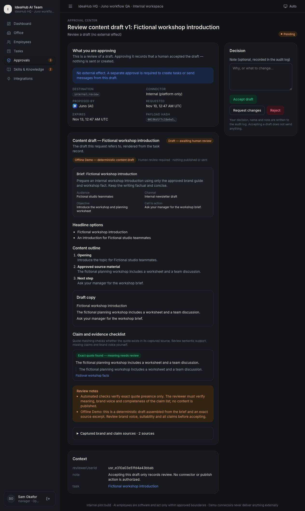
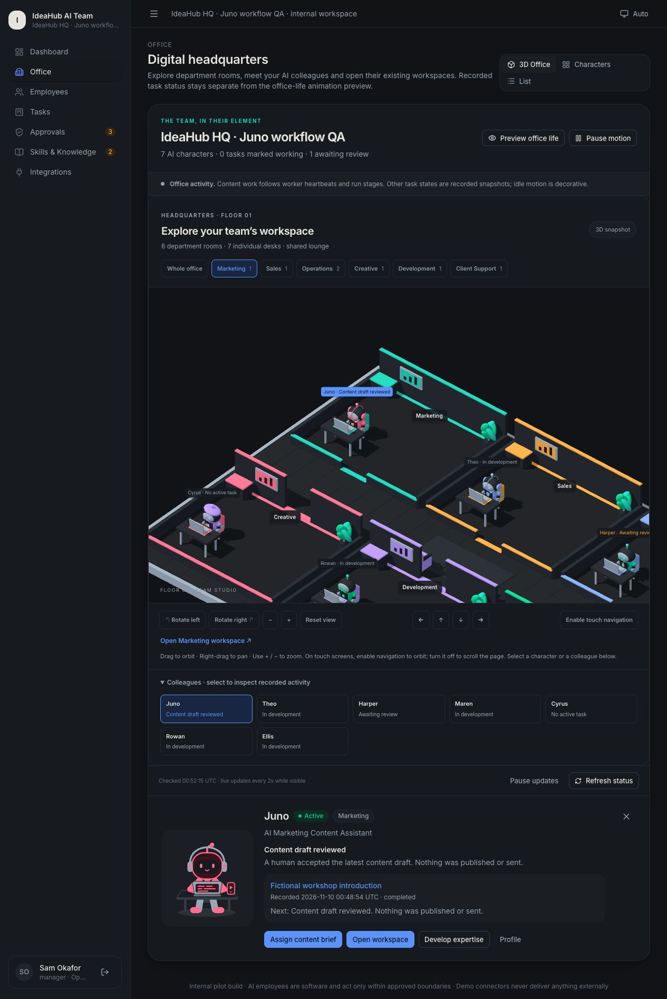
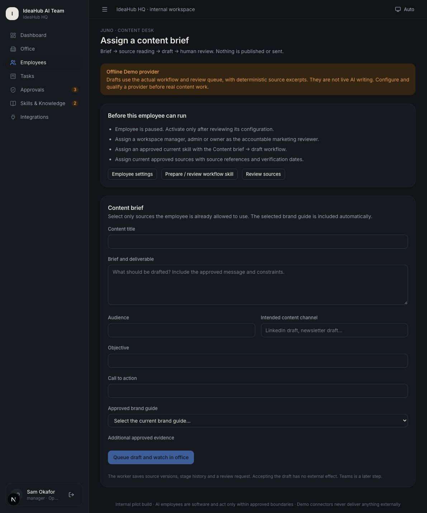

# Juno content verification — 10 November 2026

Environment: local macOS arm64, Node 24.19.0, pnpm 10.28.0 dependency tree, Next.js 16.4.5. Earlier uncommitted P0, evidence, expertise and office changes were preserved.

## Automated checks

- 183 tests pass across 17 files (169 before this slice, 14 new content tests).
- Both application and test TypeScript configurations pass.
- ESLint and `git diff --check` pass.
- Production build passes with `next build --webpack`. This uses the documented local Webpack alternative; the default Turbopack build was not requalified.
- Production server runs on loopback port 3001 against an isolated fictional database.

New tests cover deterministic Demo generation, source snapshots and stage history, human-only completion, zero delivery receipts, duplicate brief submission, requested changes/version history, readiness and emergency stop, workspace isolation, reviewer impersonation, changed source/artifact evidence, live drafting and stale-heartbeat motion, source revocation during a provider await, timeout/abort with a late response, attempt-fenced job writes, paused-run revision supersession, duplicate jobs, missing pricing, exhausted budget and unsupported claim quotes. Live-provider tests use deferred/mocked adapters with fictional credentials and no network requests.

## Browser checks

Browser QA used a separate copy of the existing fictional database, labeled **IdeaHub HQ · Juno workflow QA**. Only this copy configured Juno active with the fictional manager Sam, reviewed marketing workflow skills and two approved fictional sources. The current workspace's Juno remains paused at configuration version 1, with its source approvals and employee settings unchanged. The new schema migration was applied without resetting/reseeding that database.

Observed in the browser:

1. Juno's **Assign content brief** link opens the labeled Offline Demo form. It accepts audience/channel/objective/CTA, a brand guide and supporting facts.
2. Submitting queues a durable job and returns to her selected office spotlight. Automatic office updates change **Task queued** to **Awaiting review** without a page reload.
3. **Review request** opens the saved headline options, outline, copy, claim/quote checklist, source snapshots and human decision controls.
4. Request changes blocks the task with the reviewer note. Generating a revision preserves/supersedes v1 and creates v2 with a fresh approval. The task updates automatically to show its new artifact and review.
5. Accepting v2 completes the task. A second fresh brief was also accepted to check the final completion messages. The office shows **Content draft reviewed**, the completed task link, and an explicit statement that nothing was published or sent.
6. Marketing room focus and selected Juno survive manual activity refresh. Pause/resume updates work. Manual refresh while automatic updates are paused was checked separately after its final fix.
7. The review layout, including expanded source hashes/text, fits a 390 × 844 viewport without document overflow. The normal viewport was restored. This is layout testing, not physical-device certification.
8. The current workspace's new brief page shows all four unmet readiness gates and disables submission: paused employee, reviewer role, approved workflow skill and approved/granted sources.
9. No browser console errors were captured on the final office page. Signed-out requests to the activity endpoint are intercepted by the existing login proxy (HTTP 307), exposing no workspace activity.

Read-only database checks found two completed content tasks in QA; artifact statuses were v1 superseded + v2 reviewed for the revision test, and v1 reviewed for the second brief. These content reviews produced **zero connector receipts**. The current database has zero content tasks from this QA run.

## Evidence

## Limits and next gates

Offline drafts finish quickly; browser QA did not extend stages with fake delays. Deferred-adapter tests verify the active drafting stage, heartbeat expiry, cancellation and late-result rejection. Real model latency, writing/revision quality and provider billing remain unverified. Exact quote matching is not semantic claim verification or proof that all factual claims were cited. Reviewers retain those duties.

Only the new content path has guarded post-await writes; older chat/meeting/connector handlers are outside this execution-hardening scope. Uncertain live-call cost reservations are retained and currently need controlled manual reconciliation; no reconciliation UI was added. OS reduced-motion changes, forced GPU loss and live-provider/Teams behavior were not browser-tested in this slice.

Before real use, configure the accountable reviewer, review Juno's current skill and approved sources, activate her intentionally, configure a provider plus pricing, and qualify representative approved briefs and revisions. Teams remains planned; no tenant authorization or external delivery was attempted. No deploy, push or commit was performed.
