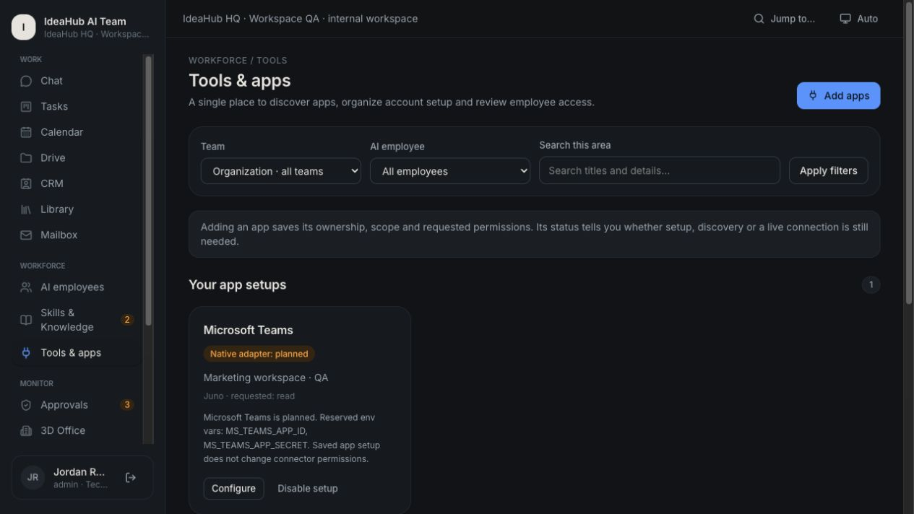
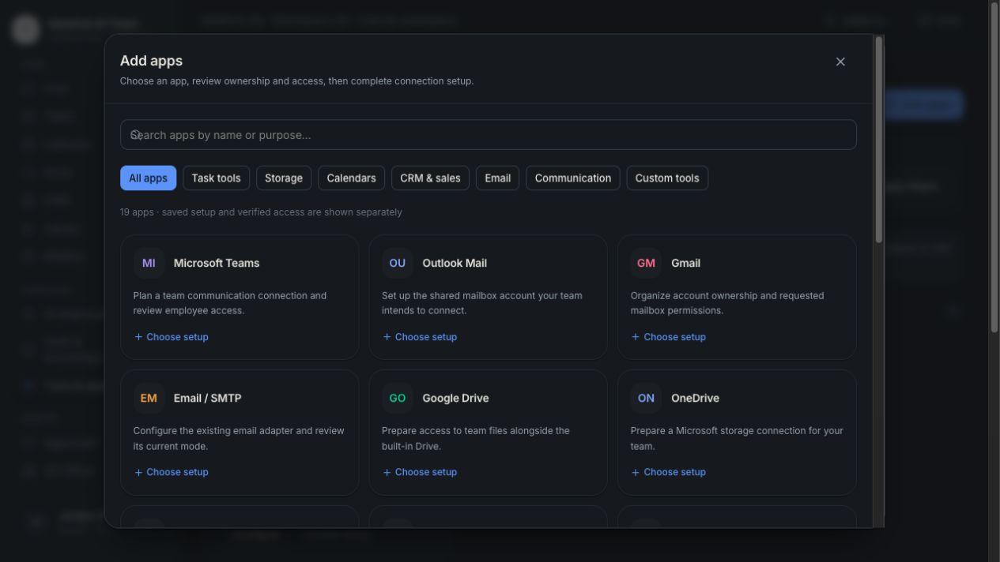
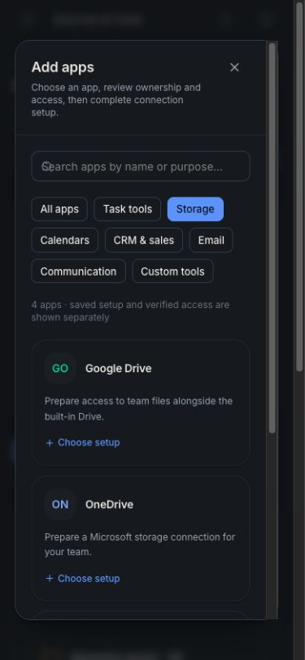

# Local verification — 7 November 2026

Environment: macOS arm64, Node 24.19.0 (within the declared >=20.9 range), pinned pnpm 10.28.0. The system default is pnpm 11.25.0; installation was explicitly run with pnpm 10 and the supplied lockfile.

## Checks

| Check | Result |
| --- | --- |
| Locked dependency install | Passed with pnpm 10.28.0 |
| Baseline tests, before edits | 35 passed in 5 suites |
| Final tests | 46 passed in 6 suites |
| App TypeScript | Passed (`tsc --noEmit`) |
| Test TypeScript | Passed (`tsc --noEmit -p tsconfig.test.json`) |
| ESLint | Passed |
| Diff whitespace check | Passed |
| Migrations + fictional seed | Passed; the original demo was seeded through the real workflow pipeline |
| Auth migrations on existing demo | Passed |
| Empty pilot setup CLI | Passed on a disposable database; a second run refused to overwrite it |
| Production build | Passed with `next build --webpack` |
| Production server | `next start` served port 3001; `/api/health` returned `ok: true`, `db: ok`; login included recovery link and excluded demo hints |

The default `next build` (Turbopack) could not complete in this desktop sandbox: its PostCSS evaluation worker failed binding a local port with EPERM. This also occurred on the unmodified baseline and persisted with a permission escalation. Webpack built the same application successfully; no application build errors were reported. The default build script remains unchanged. A normal staging/CI environment should rerun the default build.

Dependency installation reported existing ESLint 10 peer-range warnings. Lint itself passed. Vitest reported an informational warning about a future Vite config-loader default; tests passed.

## Browser demo (local fictional database)

- Signed in as Sam (manager); opened Harper's profile and workspace.
- Ran meeting record → draft action list on the 3 November Ops Sync. It rendered six actions, one missing owner, one unverified owner, three missing dates, decisions, questions and source lines.
- Accepted the draft: the artifact became reviewed; the review produced **zero receipts** (also checked directly in the database).
- Proposed task creation from the reviewed artifact; this created a separate pending approval showing the exact payload.
- Approved & simulated. The receipt showed succeeded, Demo mode and reference `DEMO-BATCH-3B328660`. Reload kept the action Executed. Database inspection confirmed **one** receipt for this approval; nothing was delivered externally.
- Ran a fresh weekly summary: completed/in-progress/blocker/decision sections rendered with task/approval record links.
- Opened both Office scene and List views.
- As manager, direct navigation to `/admin` displayed the server-side permission error.
- Signed in as Jordan (admin); activated emergency stop and verified its banner; lifted it afterward. Database inspection confirmed the stop was off at completion.
- Inspected Admin → Members: recovery controls appeared for managers/members and were absent for owner/admin targets while signed in as an admin.
- Verified the signed-out login page hides demo credentials and links to the new recovery page. Inspected the recovery instructions and labeled inputs.

Recovery issuance/consumption, revoked-issuer permissions, password change, token expiry/supersession and session revocation were tested at the service layer. No password was changed through the browser, and no email recovery delivery was claimed.

Screenshots:

## Scope and remaining work

All providers remained offline Demo, all connector effects remained simulated, and no real team identities or meeting records were supplied. Live API behavior, ten real recaps, real onboarding, known pricing and staging readiness remain unverified. Weekly summaries currently have no model-assisted mode. See `LOCAL_PILOT.md` for the local P0 changes and staging checklist.

## HQ organization verification — 10 November 2026

The workspace organization change passed **234 tests across 20 files**, app and test TypeScript checks, ESLint, `git diff --check`, and a production **webpack** build. The 31 new checks cover native shared records, app setups, local files and knowledge snapshots, calendar dates, and Library review-state regressions. Existing provider, approval, MCP and office tests pass. Vitest's existing config-loader notice remains informational.

Applied additive migration `0005_workspace_organization` to the fictional local database without resetting or reseeding it. A database backup and a separately copied browser QA database were created in the system temporary directory. Browser writes were confined to that QA copy (workspace label **IdeaHub HQ · Workspace QA**); no benchmark account records or integrations were modified.

Verified in the production build through the browser:

- Categorized Add apps dialog, search returning Microsoft Teams, guided setup with a human owner and Marketing/Juno scope, save, disable and enable. Status remained **Native adapter: planned**; no OAuth account was authorized and no native grants changed.
- Drive folder and text document creation, exact downloaded text, a real file upload, trash and restore. Uploaded files do not expose the text replacement editor.
- **Propose as knowledge** created a pending versioned source, showed **No employee**, and required separate review/access. It was left pending.
- Internal calendar event creation, editing, timezone conversion (10:00 Asia/Manila persisted as 02:00 UTC) and Agenda display. Browser testing caught date inputs not reaching the action; submission now normalizes the actual native form fields, and the corrected create/edit flow passed.
- CRM company creation, a linked contact, a proposal-stage deal at USD 1,250.50, and switching archived/current views.
- Library human newsletter draft and existing AI outputs. Reviewed artifacts appear once under Reviewed, even when an external action approval is pending. Two pending draft reviews remain in Needs review. This regression has explicit tests.
- Shared mailbox draft creation and list display with **Draft · not sent**. No send control or live inbox sync was added.
- Operations/Harper task filtering preserved across Board/List navigation; quick navigation search opened Drive.
- Team directory and scoped module links, seven employee workspace links from Chat, actual task Activity and admin-only audit summary.
- Original 3D Office rendered its existing camera/character controls and real recorded statuses, with decorative animation clearly separate.
- Mobile navigation and the contextual Storage app catalog at **390 × 844**, keyboard Escape dismissal, and contained layouts without document-level horizontal overflow. The viewport override was reset afterward.
- The main development workspace was observed with the new navigation and the existing Harper conversation intact. No browser test records were added there.

Screenshots of our fictional QA app only:

Remaining boundaries: external catalog apps still need account authorization and synchronization adapters; MCP invocation and employee tools for native module records are not enabled; files use bounded SQLite storage; Calendar has internal events rather than external invitations; native Mailbox records are shared drafts. See [WORKSPACE_ORGANIZATION.md](WORKSPACE_ORGANIZATION.md).
